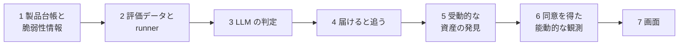

# 0001. 登録した製品の該当判定から始め、LLM の前に評価基盤を作り、外から見える資産の発見は後で足す

- ステータス: 承認
- 日付: 2026-10-30

## 文脈

- 警察庁「令和 8 年上半期におけるサイバー空間をめぐる脅威の情勢等について」では、ランサムウェアの被害報告は 123 件で半期の最多。被害組織へのアンケートでは侵入経路の約 5 割が VPN 機器で、被害企業の約 6 割が中小企業、業種は製造業が約 3 割で最多
- IPA の ASM 実証(2026-03、中小企業 126 社)では、全社で外から見える脆弱性が見つかった。診断を受けても動けない理由は、解釈と優先度を決める人がいないこと、どこまでやれば十分か分からないこと、単発の診断では変化を追えないことだった
- 外からの検出は GMO の「ネット de 診断 Lite」が 1 ドメイン月 4,280 円で出しているが、2026-01 の開始から半年で契約は十数件にとどまる(ScanNetSecurity の PR 記事による)。IPA の無料の MyJVN には、製品で脆弱性を絞り込む API と、PC の一部のソフトの版を確かめる道具はあるが、VPN 機器や業務ソフトの該当の判定と優先度付けは無い
- SCS 評価制度 ★3(2026 年度末に開始予定)は、CVSS 7.0 以上の脆弱性を直す更新を 14 日以内に当てることを求め(4-4-4)、公開サーバと VPN 機器を適用範囲に必ず含める
- 作り手は大学生 1 人。就職活動で「LLM の精度を測って改善した」話をしたく、学生起業として売上も立てたい
- 8 案を、面接官、学生起業の審査員、製造業の中小企業の社長、セキュリティ実務家の 4 つの立場で独立に採点した(1 人 20 点、4 人で 80 点)。採点したのは実在の人ではなく、同じ調査の資料だけを渡し、立場を演じさせた Claude のサブエージェントで、互いの点も Claude の事前の採点も見せていない。以下の「社長役」などの言葉と金額は、この演じた立場の答えで、顧客から聞いたものではない

| 案 | 合計 |
|---|---|
| F 登録した製品に該当する脆弱性だけを知らせる | 62 |
| A' 外から見える穴を見つけて、動かして、★3 の証跡にする | 61 |
| E 取引先のチェックシートに自動で答える | 56 |
| B' 社外の人に渡したアカウントの台帳 | 52 |

## 検討した選択肢

1. F から始め、A' へ広げる
2. A' から始める(外からの検出を最初から作る)
3. E を作る
4. B' を作る

## 決定

高橋さんが 1 を選んだ。

- LLM の判定を組み込む前に、評価データ、実行の記録、2 つの設定の比べ方を作る
- 4 は版の照合の結果だけでも届けられるようにする。LLM の精度が目標に届かなくても顧客に価値を出せる

## 理由

- F は顧客の環境に何も入れず、顧客の機器にパケットも送らないので、一人で始められ、能動的な観測の法的な線引きを後に回せる。面接官役と実務家役が 1 位にした
- 該当判定は正解を用意できる。NVD の版の範囲がそのまま正解になる部分と、人手のラベルが要る部分に分けられるので、精度を測って改善する話が作れる
- A' は社長役と審査員役が 1 位にした(社長役は「VPN の穴を日本語で教えて 14 日追うなら月 1 万円まで払う」)。外から見つけた資産も最後は F と同じ該当判定を通るので、F を先に作れば A' は入口を足すだけになる
- E は、証跡の無い項目を LLM が「実施済み」と書くと取引先への虚偽申告になり、★制度が広がるとチェックシート自体が★の提示に置き換わる恐れがある。B' は社長役が「うちの鍵は 10 本ほどで Excel で足りる」とした
- 評価を先に作るのは、LLM が該当を見逃したときの害が大きいから。重大な脆弱性を非該当と届ければ、顧客はその脆弱性を放置する。数字で確かめる前に顧客に出せない

## 受け入れたトレードオフ

- F の間は、登録されなかった製品は守れない。4 人とも、中小企業は VPN 機器の版を知らず「要確認」が増えると指摘した。保守ベンダーへの聞き方を一手として出し、申告された版を記録する流れで補う
- 社長役が払う上限は F で月 3,000 円、A' で月 1 万円だった。F だけでは売上が小さく、A' に広げるまでは事業として検証の段階にとどまる
- 評価基盤を先に作る分、顧客に届けるのは遅れる

## 再検討する条件

- 最初の顧客との対話で、製品の登録が続かない(台帳が空か古いまま)と分かったとき。5 の受動的な発見を前倒しする
- 評価で重大な見逃しを 0 にできないとき。LLM の判定を外し、版の照合と「要確認」だけで届ける
- 販路が決まり、売り手(保守ベンダーなど)が求める形が F と違うとき
