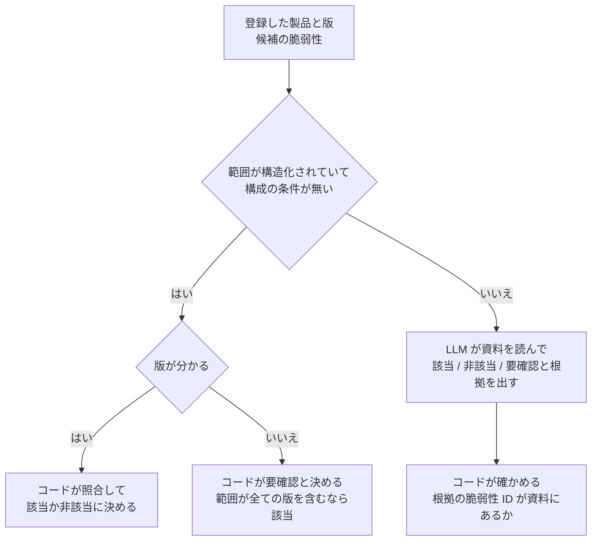

# 0002. 該当判定は「該当 / 非該当 / 要確認」の 3 つにし、版の範囲の照合はコードで行い、LLM はコードで決められない分だけを判定する

- ステータス: 承認
- 日付: 2026-10-30

## 文脈

- 登録した製品が脆弱性に該当するかは、製品が同じか、版が影響範囲に入るか、構成の条件を満たすかで決まる
- 版の範囲は NVD の CVE API 2.0 が `configurations` の `cpeMatch`(`versionStartIncluding`、`versionEndExcluding` など)に構造化して返す
- 構造化されていない情報も多い。JVN の公表文は範囲を日本語で書き(JVN#82782759 の「Apache Struts 2 バージョン7.2.1から7.3.0」)、構成の条件も文で書く(同じ公表文の「`struts.parameters.requireAnnotations=true` が有効で、`@JsonAnySetter` を宣言している場合にのみ発生」)。国産の業務ソフトや工場の機器には CPE が無いものがあり、公表直後は範囲が「詳細不明」のこともある
- 中小企業は使っている機器の版を知らないことが多い(0001 の 4 人の採点者が全員指摘した)
- 脆弱性の公表から悪用までの平均は -7 日で、公表より前に悪用が始まっている(Mandiant M-Trends 2026 を引いた e-Guardian の記事による)。範囲が不確かな公表直後こそ判定が要る
- 実務家役の指摘: 構成の条件は登録した情報に無く、LLM は該当か非該当のどちらかに倒しがち。「要確認」へ正しく逃げられるかが信頼を決める

## 検討した選択肢

1. 該当 / 非該当 / 要確認の 3 つ。版の範囲の照合はコードで行い、残りを LLM が判定する
2. 該当 / 非該当の 2 つ。決められないものは該当に倒す
3. 範囲の照合も含めて全部を LLM に判定させる
4. 全部をコードで判定し、決められないものは要確認にする(LLM を使わない)

## 決定

Claude が提案し、計画の承認で高橋さんが 1 を選んだ。

- 候補の脆弱性は、登録した製品と一致するものに絞る。絞り方(CPE、ベンダー名と製品名の揺れ)はフェーズ 1 で決める
- 範囲が構造化されていても版が分からなければ、コードが要確認と決める。範囲が全ての版を含むなら該当にする。LLM には渡さない
- LLM に渡すのは、範囲が文だけのもの(JVN の日本語の公表文や、範囲の無い NVD の記録)、版の書き方が範囲と合わず読み替えが要るもの、構成の条件があるもの
- 要確認には「何が分かれば決まるか」(版、構成の設定)を必ず付け、それを一手にする
- 誤りの重さは同じに扱わない。該当を非該当とする誤りを最も重くし、迷ったら要確認にする
- コードが決めた結果は LLM に渡さず、評価では LLM の判定の正解に使う

## 理由

- 版の範囲の照合は決定的に解ける。LLM に計算させると、再現しない誤りが入る
- 2 つにして該当に倒すと、届く通知の多くが誤報になり、兼任の担当者が読まなくなる。製品で絞るだけの MyJVN との差も消える。要確認を分ければ、何を確かめれば決まるかを一手にできる
- 全部をコードで判定すると、日本語の範囲の文、CPE の無い国産製品、構成の条件を扱えず、要確認が山になる
- 要確認は正解として定義できる(専門家でも資料だけでは決められないもの)ので、要確認を正しく出せた割合を測れる

## 受け入れたトレードオフ

- 製品ごとの版の読み方(FortiOS の `7.0.12`、Cisco ASA の `9.16(4)`、OpenSSH の `9.2p1`)をコードに書く手間がかかる
- 要確認が多いと価値が下がる。要確認の割合を指標として追う
- 簡単な例はコードが解くので、LLM の評価データは難しい例に偏る

## 再検討する条件

- 要確認の割合が高く、顧客が通知を読まなくなったとき
- NVD の分析が遅れ、範囲の無い記録が増えたとき
