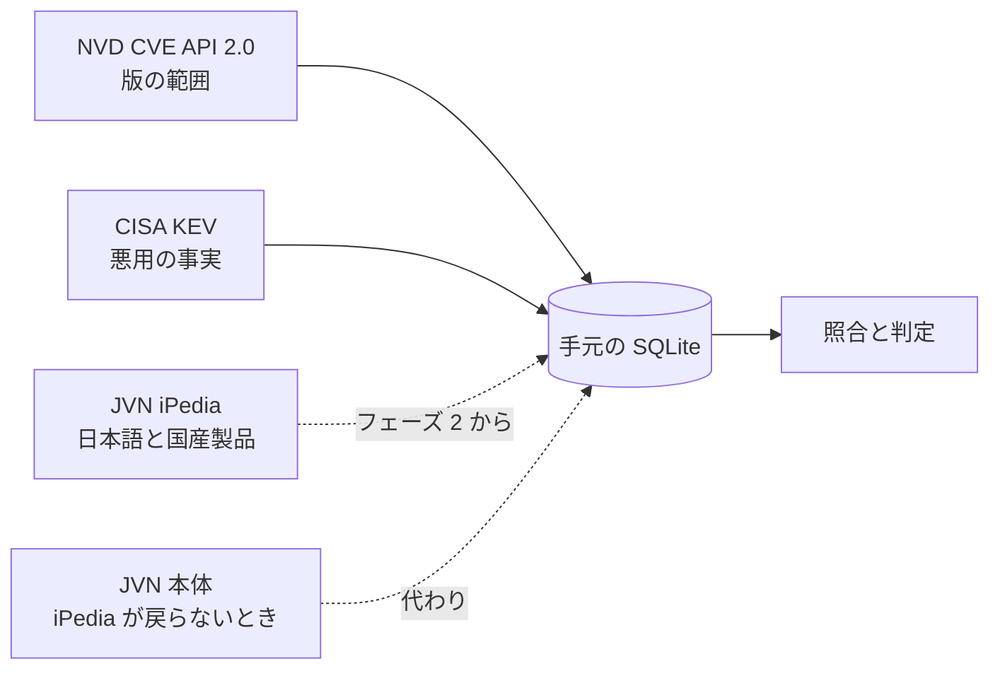

# 0003. 版の範囲は NVD、悪用の事実は CISA KEV から取り、日本語の情報は JVN iPedia から取る。iPedia が戻らなければ JVN 本体を読む

- ステータス: 承認
- 日付: 2026-10-30

## 文脈

- 0002 で、版の範囲の照合はコードで行うと決めた。照合には構造化された範囲が要る
- 優先度は、実際に悪用されているかで大きく変わる
- 日本語の情報が要る場面は 3 つある。LLM の評価データの入力(日本語の範囲の文と構成の条件)、一手の材料(対策の日本語)、CPE の無い国産製品(三菱電機の制御機器など)。どれもフェーズ 2 から要る
- 2026-10-30 に、各取り込み元を実際に呼んで確かめた

| 取り込み元 | 状態 | 取れるもの |
|---|---|---|
| NVD CVE API 2.0 | 応答あり | `configurations` の `cpeMatch` に NVD が付けた版の範囲、`affected` に採番機関(Fortinet など)が書いた範囲、`cisaExploitAdd` と `cisaActionDue` に KEV への掲載日と対応の期限。英語。CVE-2024-21762 で確かめた |
| CISA KEV の JSON | 応答あり。版 2026.10.29、1,764 件 | `cveID`、`vendorProject`、`product`、`dateAdded`、`dueDate`、`knownRansomwareCampaignUse` など |
| JVN 本体の RSS | 応答あり | 識別子、題、要約、日付だけで、CPE は無い。公表文の HTML には影響を受けるシステム、構成の条件、対策が日本語で書いてある |
| JVN iPedia と MyJVN | 2026-10-22 からシステムメンテナンスで全サービスが停止。停止ページは 11 月中の再開見込み、JVN のお知らせは再開時期未定。仕様書のページも読めない | 再開すれば、JVN 本体の公表文と海外製品の情報を CPE つきで API から取れる |

## 検討した選択肢

1. NVD と KEV を土台にし、日本語は JVN iPedia から取る。iPedia が戻らなければ JVN 本体を読む
2. NVD と KEV を土台にし、日本語は JVN 本体の RSS と HTML から取る
3. NVD と KEV だけで作り、日本語の取り込み元は持たない(LLM が英語の情報から日本語の一手を書く)
4. MyJVN API を停止前の仕様に合わせて作り、再開を待つ

## 決定

Claude が条件付きの方針を提案し、高橋さんが「iPedia の方が良さそう」として 1 を選んだ。

- フェーズ 1 は NVD と KEV だけで作る。毎日、前回からの更新分を取り込み、手元の SQLite に写す。照合と判定は写したものだけを読み、外の API を呼ばない
- どこまで写すか(全件か、登録した製品に関わる分か)と、NVD が範囲を付けていない記録で採番機関の範囲を使うかは、フェーズ 1 で決める
- 日本語の取り込み元は、フェーズ 2 に入る時点で決める。iPedia が再開していて、新しい仕様が読め、実際に応答すれば iPedia を使う。そうでなければ JVN 本体の RSS と HTML を読む
- 取り込む前に、それぞれの利用条件を確かめる。外の API は間を空けて 1 本ずつ呼び、NVD は API キーを取る

## 理由

- NVD は、製品を問わず版の範囲を構造化して無料で返す。NVD が付けた範囲と採番機関が書いた範囲の両方が 1 回の応答で取れる。ベンダーの CSAF やオープンソースの OSV も範囲を構造化しているが、対象がそのベンダーやオープンソースの製品に限られる
- KEV は悪用の事実を最も確かに示し、無料で、1 つのファイルで取れる。NVD の応答にも KEV への掲載日と対応の期限(`cisaActionDue`)は入るが、ランサムウェアで使われたか(`knownRansomwareCampaignUse`)は KEV にしか無い
- iPedia は JVN 本体の公表文を含み、CPE が付き、API で取れる。HTML を読むより壊れにくく、範囲も広い
- 2 の JVN 本体だけでは件数が少なく、HTML の形が変われば取り込みが壊れる
- 3 では CPE の無い国産製品を扱えず、日本語の範囲の文を読む評価が作れない
- 4 は今は一度も試せず、停止がシステムの入れ替えなら仕様が変わりうる
- 照合を手元に写したものから行うのは、取り込み元が止まっても判定と通知を止めないため。今回の iPedia の停止がその例になる

## 受け入れたトレードオフ

- フェーズ 1 の間は英語の情報だけで、CPE の無い国産製品は判定できない
- iPedia の再開がフェーズ 2 に間に合わなければ、JVN 本体の HTML を読む部品を作り、iPedia が戻ったら作り直すことになる
- 手元に写す分、取り込みの手間と DB の大きさが増える

## 再検討する条件

- NVD の分析が遅れ、範囲の無い記録が増えたとき(0002 と同じ)
- JVN iPedia か JVN 本体の利用条件が、取り込みや一手での引用を認めないと分かったとき
- 有料の脆弱性情報が、学生の予算で使える値段で、国産製品と日本語を含むと分かったとき
- 顧客の機器の多くが、CSAF を出すベンダーの製品だと分かったとき(そのベンダーの CSAF を取り込み元に足す)
