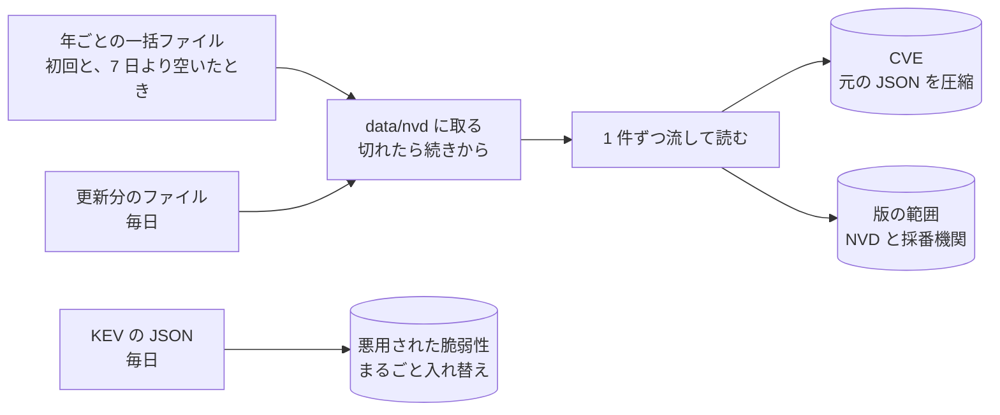

# 0004. NVD は一括ファイルで全件を写して元の JSON を圧縮して持ち、NVD と採番機関の版の範囲を表に展開する。KEV は毎日まるごと入れ替える

- ステータス: 承認
- 日付: 2026-10-30

## 文脈

- ADR 0003 で、版の範囲は NVD、悪用の事実は CISA KEV から取り、手元の SQLite に写したものだけで照合すると決めた。どこまで写すかと、NVD が範囲を付けていない記録で採番機関の範囲を使うかは、フェーズ 1 に残した
- 2026-10-30 に確かめた NVD の配り方は 3 つある

| 配り方 | 中身 | 大きさ |
|---|---|---|
| CVE API 2.0 | 全 416,968 件。1 回に 2,000 件まで | API キーが無いと回数の制限が厳しい |
| 年ごとの一括ファイル | 2002〜2026 年の 25 本。中身は API と同じ形 | gzip で合わせて約 300MB、展開すると約 3.5GB。2026 年分だけで gzip 42.6MB、展開 500MB |
| 更新分のファイル | 直近 8 日に変わった CVE。2 時間ごとに出る | gzip 13.2MB |

- 一括ファイルは途中からの取り直しに対応している(`Accept-Ranges` と `ETag`)。この環境からの取得は毎秒約 47KB で、25MB のファイルが 5 分で取り終わらなかった。全件の取得には 1 時間半ほどかかる
- NVD 自身が付ける版の範囲(`configurations`)は減っている。採番機関が書く範囲(`affected`)は、ほぼ全件にある。ADR 0002 と 0003 の再検討の条件「NVD の分析が遅れ、範囲の無い記録が増えたとき」に、すでに当たっている

| 範囲 | 件数 | NVD の範囲がある | 採番機関の範囲がある |
|---|---|---|---|
| 2024 年の一括ファイル(取り消しを除く) | 38,495 | 77.6% | 100% |
| 2025 年の一括ファイル(取り消しを除く) | 43,644 | 59.7% | 100% |
| 直近 8 日に公表された分(取り消し 219 件を含む) | 3,969 | 3.4% | 94.5% |

- 採番機関の範囲は、版の書き方(`versionType`)がまちまちである。2025 年では未記入が 111,812、`custom` が 42,923、`semver` が 30,240、`git` が 14,436、`rpm` が 11,053 だった。`git` はコミットの番号で、大小を比べられない
- 元の JSON を詰めて zlib で縮めると、1 件あたり約 1.6KB だった(2024 年と 2025 年の先頭 5,000 件)。全件では 0.5〜0.7GB になる見込み
- 展開した一括ファイルを一度に読み込むと、2026 年分は Python で数 GB のメモリを使う。小さな VPS のメモリには載らない
- KEV は 1 つの JSON で、2026-10-30 の版(`catalogVersion`)は 2026.10.29、1,764 件だった。日付は `YYYY-MM-DD` で、ランサムウェアで使われたか(`knownRansomwareCampaignUse`)は `Known` か `Unknown` のどちらか

## 検討した選択肢

写す範囲

1. 全件を年ごとの一括ファイルで入れ、毎日は更新分のファイルを入れる
2. 登録した製品に関わる分だけを API で取る
3. 全件を API で取る

持ち方

- A. CVE ごとに元の JSON を圧縮して持ち、照合に使う範囲だけを表に展開する
- B. 照合と表示に要る項目だけを列と表に分けて持ち、元の JSON は捨てる
- C. 元の JSON を圧縮せずに持ち、SQLite の JSON 関数で調べる

## 決定

高橋さんが 1 と A を選んだ。

- 初回と、前回の取り込みから 7 日より空いたときは、年ごとの一括ファイルを全部入れる。それ以外は更新分のファイルだけを入れる。更新分は直近 8 日分なので、1 日の余裕を持たせる
- ファイルは `data/nvd/` に取ってから読む。途中で切れたら続きから取り直し、取り終えてから本来の名前に付け替える。続きを取るときは、ETag が変わっていないことを確かめる
- ファイルは 1 件ずつ流して読み、全体をメモリに載せない
- CVE ごとに、ID、公表日時、更新日時、状態(取り消しなど)と、元の JSON を zlib で縮めたものを持つ。手元より更新日時が新しいものだけを書き換える
- 版の範囲は、出どころ(NVD か採番機関か)を付けて 1 行ずつ表に展開する。CVE を書き換えるときは、その CVE の範囲を全部消してから入れ直す
- 照合で 2 つの出どころの範囲をどう使うかは、版の照合を作るときに ADR で決める
- KEV は毎日取り、版が手元と同じなら何もしない。違えば表をまるごと入れ替える。取った一覧が空なら入れ替えずに失敗とする
- KEV は小さく、いつでも取り直せるので、元の JSON は持たない。照合、優先度、一手に使う項目(CVE の ID、掲載日、対応の期限、ランサムウェアで使われたか、求められる対応)だけを持つ
- 取り込み元ごとに、版と最後に書き込んだ日時を表に残す

## 理由

- 一括ファイルなら、API キーも回数の制限も要らない。全件が手元にあれば、製品を登録したその場で照合でき、フェーズ 2 の評価データ(JVN と NVD に共通の CVE)も手元から作れる
- 2 は登録のたびに API を呼び、製品の特定を誤ると取りこぼす。3 は中身が一括ファイルと同じで、回数の制限の分だけ遅い
- 元の JSON を持てば、表の形を変えても取り直さずに作り直せ、評価の入力も元のまま残せる。この環境では全件の取り直しに 1 時間を超えるので、取り直さずに済む値打ちが大きい。B は項目を足すたびに取り直しになり、C は 3.5GB になる
- NVD の範囲は、2025 年の分で 4 割、公表直後の分ではほとんど付いていない。公表直後こそ判定が要る(ADR 0002)ので、採番機関の範囲も写さないと、新しい脆弱性の多くをコードで照合できない
- 1 件ずつ流して読めば、展開 500MB のファイルでも、メモリは CVE 1 件分で済む
- 空の KEV で表を入れ替えると、悪用の事実が全て消え、優先度が黙って下がる。空なら失敗にして気づけるようにする

## 受け入れたトレードオフ

- 手元の DB が 0.5〜0.7GB になる。VPS のディスクには置ける
- 初回の取り込みは、この環境の速さでは 1 時間半ほどかかる
- 依存に、1 件ずつ流して読むための ijson が増える
- 採番機関の範囲には、git のコミット番号のように大小を比べられない書き方が混ざる。比べられないものは要確認になる(ADR 0002)

## 再検討する条件

- NVD が一括ファイルの配布をやめたとき(API で全件を取る形に替える)
- DB の大きさが置き場所に収まらなくなったとき
- 採番機関の範囲の書き方が揃わず、要確認が増えすぎたとき
