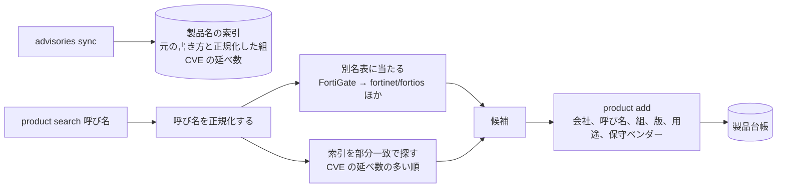

# 0007. 登録した製品は、写した CVE の名前を正規化した組に結びつけ、候補は部分一致と手書きの別名表で出す。台帳は会社ごとに持つ

- ステータス: 承認
- 日付: 2026-10-30

## 文脈

- ADR 0001 で、使っている製品と版を登録してもらい、該当を判定する形から始めると決めた。ADR 0002 で、候補の脆弱性を登録した製品と一致するものに絞り、絞り方はフェーズ 1 で決めると残した
- 2026-10-30 に全件の写し(416,968 件)で名前を数えた。NFKC にそろえて小文字にし、英数字とかなと漢字だけを残すと、ベンダーと製品の組は 199,817 あった(元の書き方は 222,873)
- 同じ製品が何通りにも書かれる。FortiOS は `fortinet/fortios`(482 件)、`fortinet/fortinetfortios`(39 件)、`fortinetinc/fortios`(8 件)など。Cisco ASA は 5 通り以上ある。Ivanti Connect Secure は、旧名の Pulse Connect Secure(57 件)でも書かれる
- 中小企業は機器の名前で呼ぶが、脆弱性は中で動く OS に付く。FortiGate は 4 件、FortiOS は 482 件だった
- 国産のメーカーも英語で書かれる。`mitsubishielectric` の製品は 1,104 組あり、`三菱電機` は 0 組だった
- 販路の候補の 1 つは、保守ベンダーや SIer が自分の顧客の分をまとめて見る形である

## 検討した選択肢

候補の出し方

1. 正規化した名前の部分一致に、手書きの別名表を先に当てる
2. rapidfuzz の類似度で並べる
3. SQLite の FTS5 で全文を検索する

台帳の単位

- A. 最初から台帳の行に会社を持つ
- B. 1 つの DB に 1 社

## 決定

高橋さんが 1 と A を選んだ。Claude が次のように具体にした。

- 名前の正規化は domain に置く。NFKC にそろえて小文字にし、ASCII の英数字とかなと漢字だけを残す。ベンダーと製品のそれぞれを正規化した組を、名前の鍵とする
- NVD の取り込みで書き換えがあったら、2 つの範囲の表から、元の書き方ごとに正規化した組と CVE の延べ数を持つ索引を作り直す。照合は、登録した組からこの索引を経て、元の書き方で範囲の表を引く
- 別名表は、リポジトリの TOML に手で書く。呼び名(英語と日本語)から、名前の鍵の一覧を引く。最初は、中小企業に多い VPN 機器と境界の機器(FortiGate、Cisco ASA、Palo Alto、Ivanti Connect Secure、SonicWall、Citrix NetScaler、Sophos)と OpenSSH、Exchange を入れる
- 候補は、別名表に当たったものを先に、次に索引の部分一致を CVE の延べ数の多い順に出す
- 製品台帳は、会社、呼び名、名前の鍵の一覧、版、用途、保守ベンダーを持つ。名前の鍵は 1 つ以上で、索引にあるものだけを受け付ける。版は申告されたときだけ文字のまま持ち、無ければ照合で要確認にする(ADR 0002)。用途は VPN 機器、サーバ、業務ソフト、工場の機器、その他

## 理由

- 部分一致は依存を増やさず、なぜその候補が出たかを説明できる。登録するのは兼任の担当者や保守ベンダーで、候補が出た理由が分かる方が選びやすい
- 2 は綴りの揺れに強いが、閾値の調整が要り、誤った候補が上に来る。3 は語に切れない日本語の製品名に弱い
- 書き方の揺れは、1 つの製品に名前の鍵を複数結びつければ吸収できる。機器の名前と OS の名前のずれは、コードでは決められないので別名表で手で埋める
- 別名表をリポジトリに置けば、レビューで育て、変えた理由をコミットに残せる
- 会社の列は今は 1 つの手間で済み、卸しの販路にそのまま乗る。後から足すと、表の作り直しと移行が要る

## 受け入れたトレードオフ

- 部分一致は綴りの誤りを拾わない。呼び名が索引のどれにも含まれなければ、候補が出ない
- 別名表は手で育てる。載っていない機器は、担当者が索引の名前から選ぶことになる
- CVE の延べ数は、NVD と採番機関の両方に載る CVE を 2 度数える。並べる目安にだけ使う
- 索引の作り直しに、全件で数秒から数十秒かかる

## 再検討する条件

- 候補が出ずに登録をあきらめる例が続いたとき(類似度を足すか、LLM で呼び名を読み替える)
- 別名表が大きくなり、手で保つのが重くなったとき
